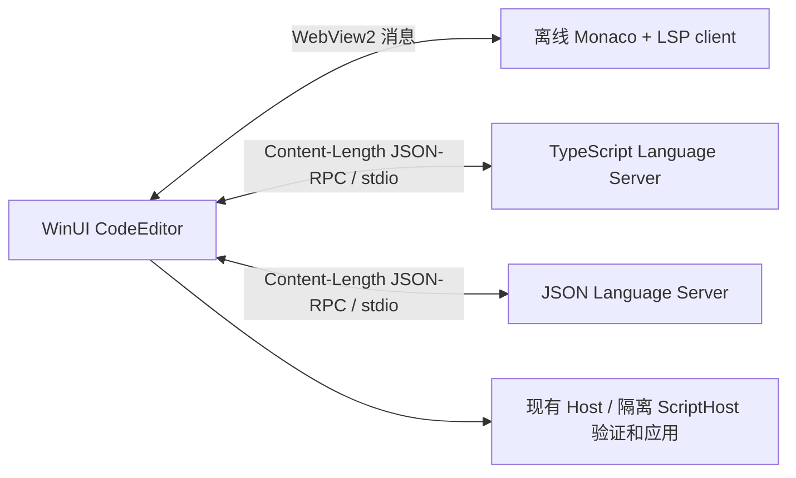

# 代码编辑器与本地 LSP

设置的 JavaScript、参数 JSON、规则清单、计薪时段和日期覆盖均由原生 `CodeEditor` 承载。WinUI 负责标题、按钮、状态、主题、草稿与配置应用；WebView2 内的 Monaco 负责编辑区域。



语言服务为真实 LSP 连接。Monaco 的内建 JS/JSON 语义服务关闭，保留语法着色；补全菜单、悬浮说明、错误标记和格式化通过语言服务器处理。没有监听本机 HTTP / WebSocket 端口。

JS 工作区包含同源 `sdk/workfor-api.d.ts` 和从当前参数 Schema 生成的声明。入口参数仅在发给 LSP 的分析文档中附加类型，并将请求与响应位置映射回原文；保存草稿与执行规则不包含合成注释。JSON 关联计薪时段、日期覆盖、规则清单或自定义参数 Schema。编辑器提示辅助编辑，完整 Draft 2020-12 和业务校验仍由 Host / ScriptHost 执行。

每个已加载的编辑器拥有独立语言服务工作区与进程；未展开、未访问的编辑器不启动浏览器或 LSP。设置关闭时释放 WebView2、语言服务器和子进程；Windows Job 保证界面异常退出也不会留下服务器。临时工作区位于 `%LOCALAPPDATA%\WorkFor\EditorWorkspaces`，浏览器配置位于 `%LOCALAPPDATA%\WorkFor\WebView2`。原生消息带配置代次，过时的页面消息不会覆盖新草稿；验证、预览和应用前主动读取编辑器当前值。

静态页面、Monaco、字体、worker、Node 和语言服务器全部离线打包。WebView2 通过 `https://workfor-editor.invalid` 映射包内资源；导航和窗口创建限定在此编辑器。类型自动下载和远程 Schema 获取关闭。用户脚本只作为文本分析，不在浏览器或 Node 中执行。

## 构建

- Monaco 0.57.0；TypeScript Language Server 6.0.3；TypeScript 6.0.2；JSON Language Server 1.3.4。
- Node 26.13.0 随包分发，从官方 zip 固定 SHA256 引导；用户不需要全局 Node 或 npm。
- 开发机需要 Node 22+ / npm。`build-editor.ps1` 使用完整 npm 锁恢复，并以 esbuild 0.28.2 构建；UI 的 build / publish 自动调用并收集资源。
- npm 依赖锁、第三方许可及随包运行时进入发行文件 SHA256 清单。打包缺少编辑器或 LSP 文件时失败。

```powershell
./scripts/build-editor.ps1
./scripts/test-editor.ps1
```

## 验证

纯 Node 测试覆盖入口解析、分析文档的位置往返、Windows URI 规范化，避免注释或字符串中的伪入口干扰补全。`scripts/build.ps1 -Test` 会运行这些检查。

`scripts/test-editor.ps1` 在自己的 WinUI 窗口内运行真实 WebView2 和随包语言服务器，检查语法 token、实际补全菜单、SDK / ctx / 参数补全、Schema 错误、原生格式化按钮的数据回传、主题、重新挂载和过时消息拒绝。它不修改用户工资或规则。还需单独扩展复杂 Schema 类型映射、完整高对比度和键盘读屏矩阵。
