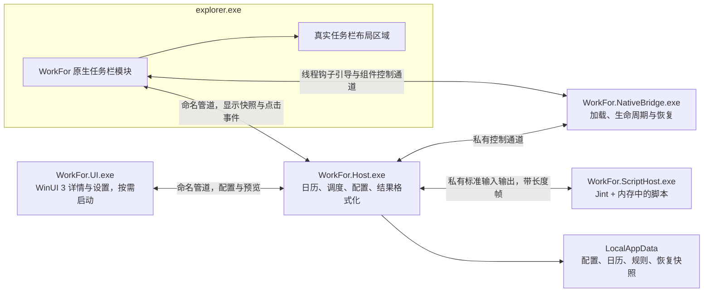

# WorkFor 整体技术架构设计

设计日期：2026-10-30，Asia/Shanghai。状态：可评审设计，任务栏适配尚待原型验证。

本文采用当前稳定最新版依赖；确切版本、核实方式与升级规则见[依赖与构建](依赖与构建.md)。脚本的规范性定义见[脚本 API](脚本API规范.md)。

## 1. 架构结论与平台限制

### 1.1 产品约束

1. 只支持 Windows，采用原生窗口和原生控件。
2. 在任务栏内部获得实际的横向布局空间；托盘图标、靠边悬浮窗和遮盖任务栏的窗口不算实现该要求。
3. 收入由用户 JavaScript 自定义规则计算，默认每秒重算并发布。
4. 没有开始、暂停、继续计时或手动刷新功能。用户设定计薪规则与日历后持续运行。
5. 视觉遵循微软 Fluent；系统主题、缩放、键盘与辅助功能优先。
6. 默认只在本机运行，不依赖服务器、浏览器或 Node.js。
7. 源码、默认规则、类型声明、协议和依赖锁文件全部纳入 Git；个人工资和运行数据不入库。

### 1.2 必须纠正的前提

**不能把 Windows 10 的 DeskBand 直接用于 Windows 11 新任务栏。** 微软的 Windows 11 功能变更页面明确列出应用不能再自定义任务栏区域。`IDeskBand2` 文档存在，并不表示新任务栏会加载它。

本机调研结果为 Windows 11 25H2、内部版本 26200.9457。注册表中的 `ProductName` 可能保留 Windows 10 字样，平台判断必须使用版本号、构建号及实际任务栏结构，不能只比较产品名称。该观察只用于确定首轮验证环境，不代表已完成兼容性测试。

资料：[微软 Windows 11 功能变更](https://www.microsoft.com/en-us/windows/windows-11-specifications)、[传统 DeskBand](https://learn.microsoft.com/en-us/windows/win32/shell/band-objects)。

### 1.3 主路线

**Windows 11 x64 + 自带 C++ 加载器与任务栏 DLL + .NET 后台宿主 + 独立 Jint 脚本进程 + 按需启动的 WinUI 3 界面。**

用户只安装 WorkFor，运行时不依赖 Windhawk 或其他任务栏修改框架。`WorkFor.NativeBridge.exe` 负责识别目标 Explorer、引导 DLL、监督生命周期和恢复；`WorkFor.Taskbar.dll` 负责进程内任务栏适配与显示。原生库静态编入产物，构建工具不要求安装在用户机器上。

公开的 Windows 钩子接口只解决 DLL 进入目标线程的问题，不会自动提供任务栏布局接口。布局接入仍使用系统内部实现，微软没有提供兼容性承诺；Windows 更新后可能需要调整适配器。详细方案见[自带任务栏组件](自带任务栏组件.md)。

可参考的上游项目已经在 Windows 11 任务栏中添加原生控件并修改布局。这为技术原型提供实现依据，但不能替代本项目对金额区域、布局预留及版本兼容的验证。

资料：[线程钩子接口](https://learn.microsoft.com/en-us/windows/win32/api/winuser/nf-winuser-setwindowshookexw)、[原生任务栏控件与布局参考](https://github.com/ramensoftware/windhawk-mods/blob/main/mods/taskbar-folder-menus.wh.cpp)。后者仅为布局研究资料，不是运行依赖或待分发模块。

### 1.4 平台支持范围

| 平台 | 实现路线 | 首版承诺 |
|---|---|---|
| 本机 Windows 11 25H2 x64，标准任务栏 | 自带 NativeBridge + Taskbar DLL | 首要验证目标，原型通过后才标记支持 |
| Windows 11 24H2、其他补丁版本 | 复用协议，分别维护能力探测与适配记录 | 逐项验证后加入支持表 |
| Windows 11 ARM64 | 需对应加载器、编译链、符号及实机验证 | 暂不承诺；不得用 x64 模块注入 ARM64 Explorer |
| Windows 10 旧任务栏 | 可独立实现 C++/COM `IDeskBand2` 模块 | 可选后续路线，不进入首版交付 |
| ExplorerPatcher / StartAllBack 替换任务栏 | 独立兼容场景 | 首版不承诺与其共存 |
| 被系统策略阻止进程钩子的环境 | 识别加载失败并报告原因 | 计算与设置可运行，嵌入功能不可标记成功 |

自带加载器属于首版必须实现的模块；加载成功、布局成功和安全停止需分别验证。不能把系统 `SetWindowsHookEx` 调用返回成功等同于嵌入功能已完成。

## 2. 总体结构与进程



### 2.1 进程职责

| 进程 / 模块 | 常驻性 | 职责 | 明确禁止的工作 |
|---|---|---|---|
| Explorer 内的原生模块 | 随任务栏存在 | 预留布局、创建文本控件、消费快照、发送点击 | 执行脚本、读工资文件、等待管道或网络 |
| `WorkFor.NativeBridge.exe` | 随 Host 运行，每个会话一份 | 发现目标、线程钩子引导、租约、兼容检查、故障隔离 | 修改其他用户进程、注入任意 DLL、业务计算 |
| `WorkFor.Host.exe` | 每个用户会话一份 | 绝对时间计算、日历、调度、规则版本、进程监督、IPC、持久化 | 创建浏览器运行时；在消息线程上执行用户代码 |
| `WorkFor.ScriptHost.exe` | 宿主运行期间一份 | 使用 Jint 执行一次纯计算，返回结构化数据 | 直接操作任务栏、加载 CLR 类型、访问文件和网络 |
| `WorkFor.UI.exe` | 首次点击时启动；关闭最后窗口后退出 | 详情、规则编辑、参数、日历、预览与错误详情 | 自己维护金额累加器或直接写活动配置 |

本项目在同用户、同会话、同完整性级别的标准 Explorer 下设计为普通用户运行，无需 Windows Service 或最高权限计划任务。NativeBridge 不提权、不绕过系统策略；实际能否加载需在 P0 验证。不同架构、权限或策略阻断时明确报告不支持。

每个登录会话独立运行，互斥体和管道名同时包含当前用户 SID 与会话 ID。默认只占用主显示器任务栏；多显示器显示同一个结果，不启动多份计算器。

### 2.2 代码模块与小接口

| 模块 | 对外接口 | 隐藏的实现 |
|---|---|---|
| `Calendar` | `BuildContext(now, revision)` | 时区、计薪区间、月度计划、假日和跨午夜 |
| `RuleRuntime` | `Evaluate(context, cancellation)` | Jint、预算、导入、结果验证、错误位置 |
| `SnapshotPublisher` | `Publish(snapshot)` | 订阅、慢客户端、重连、主题无关显示数据 |
| `Configuration` | `ValidateCandidate` / `Activate(expectedRevision)` | 原子写入、版本冲突、候选规则和回滚 |
| 原生 `TaskbarAdapter` | `Attach` / `Update` / `Detach` | 系统版本、原生 XAML、空间预留、资源释放 |
| 原生 `BridgeController` | `EnsureAttached` / `QueryState` / `RequestDetach` | 目标身份、引导钩子、进程租约、兼容清单、重试 |

规则执行、配置候选和系统任务栏都是实际会变化的地方，才设接口；金额传递不再叠加无行为的多层转发。

## 3. Windows 11 任务栏接入实现

### 3.1 不在 Explorer 内加载 WinUI 3

任务栏进程已拥有自己的 UI 框架和线程。参考实现使用 `Windows.UI.Xaml` 系统 XAML 类型；本项目应在其实际可视树中创建同一套框架的控件。不能向该树直接插入 `Microsoft.UI.Xaml` 的 WinUI 3 控件，也不能为了“最新版”把私有版本 WinUI 加载到 Explorer。

任务栏区域采用 C++23、Win32、C++/WinRT 与系统控件；详情和设置在独立进程使用最新 Windows App SDK / WinUI 3。这两个层面都采用微软原生控件，但二进制与 UI 树完全分离。

### 3.2 适配状态机

```text
Uninitialized -> Discovering -> Bootstrapping -> Negotiating -> Attaching -> Attached
                      |              |               |            |          |
                      +--------------+---------------+------------+          v
                      |                                           Detaching -> Dormant
                      v
                Unsupported / Quarantined
```

1. NativeBridge 枚举当前会话任务栏，验证其所属 Explorer 的路径、PID、创建时间、架构、完整性级别及兼容条目。
2. 从版本目录按绝对路径装载自有 DLL，获取 `WorkForBootstrapHook`，为目标线程注册 `WH_GETMESSAGE` 钩子并投递引导消息。DLL 在 Explorer 内的 `DllMain` 只做最小初始化。
3. DLL 钩子回调把初始化转交到自身控制流程，完成和 NativeBridge 的握手；引导钩子在确认 DLL 的生命周期自持后移除，不常驻监听任务栏所有消息。
4. 根据模块指纹与实际 UI 结构选择适配器，把 `Attach` 投递到真实 XAML 所有者线程；创建、修改与销毁控件均在该线程执行。
5. 完成空间预留并验证邻接元素不重叠后，发布 `Attached`。未通过时撤销本次改动，报告 `Unsupported`。
6. Explorer 重启后重新发现、重新握手、重新附着；Host 重启而 Explorer 未退出时优先重连同版本休眠模块，不重复加载新 DLL。
7. 停止时撤销控件、事件、计时器、IO 与业务回调，确认逻辑分离。首版保守地让 DLL 代码保留到 Explorer 退出，不能把取消钩子当作任意时刻物理卸载的证明。

详细时序、模块驻留、升级规则和内部协议见[自带任务栏组件](自带任务栏组件.md)。以上为实施设计，尚未编译或执行注入原型。

### 3.3 怎样保证真正占用空间

适配器必须将自有容器加入任务栏布局，并把请求宽度纳入任务栏测量与排列过程。必要时调整插入点所在 Grid 的列、布局宽度或原生测量钩子，使应用按钮区域实际缩短或参与系统溢出计算。

不能只在任务栏的空白位置 `SetParent` 一个窗口，也不能仅移动已有按钮来“看起来空出位置”。这些做法可能在图标增多时重叠，不满足本项目验收。

首个原型要分别证明：

- 插入位置位于应用按钮与系统托盘之间，且模块宽度参与原生布局。
- 持续打开应用直到任务栏拥挤时，系统按钮、收入区域、托盘互不覆盖。
- 居中与左对齐均能得到确定布局；无法支持的模式明确标记，不模拟成功。
- 移除模块后恢复当前布局，而不是把 Explorer 或其他模块后来做的更改覆盖为启动时快照。

具体 Grid 名称、内部函数名、符号签名由原型确认后写入 `compatibility.json`。文档不虚构一个“通用稳定内部接口”。如只能找到绘制位置却无法影响测量，该适配器仍属失败。

### 3.4 模块内部线程

- **UI 线程**：仅更新短文本和交互状态；不等待锁、网络、子进程和管道连接。
- **IO 线程**：Overlapped named-pipe IO，消费有大小限制的快照；断开后指数退避重连。
- **快照交换**：后台先验证完整快照，再替换不可变共享对象；投递一个合并后的 UI 更新，同一时刻最多一个待处理更新。
- **停止**：停止标志 + `CancelIoEx`；对象生命周期使用 RAII、弱引用和事件撤销器。钩子出口不得向 Explorer 抛出异常。首版采用逻辑分离后休眠驻留策略，不在仍可能被调用时释放 DLL 或 trampoline。

回调退出前需处理取消与卸载竞争；不能依赖 SEH 或“捕获所有异常”来恢复任意内存破坏。Explorer 崩溃仍是进程内代码的实际风险，首版模块必须足够小。

### 3.5 宽度与降级布局

默认请求宽度 260 DIP，允许 180—360 DIP；实际值由适配器的空间探测决定。任务栏高度、文字缩放和显示器 DPI 都读系统值，不写死 48px。

空间不足时依次隐藏“实时更新”、隐藏“今日收入”，最后仅显示金额；最小区域仍放不下时移除本模块并报告空间不足，不覆盖时钟或应用图标。宽度只在配置、DPI、数字位数或空间状态变化时重算，不每秒重新测量整条任务栏。

默认只更新发生变化的文本。金额小数按宿主格式化，使用系统字体的等宽数字特性；不制作数字滚动动画。高对比度、减少动画、文本缩放和透明效果关闭均继承系统设置。

### 3.6 旧任务栏可选适配器

若扩展 Windows 10，可增加独立的 `WorkFor.DeskBand.dll`：实现 `IUnknown`、`IObjectWithSite`、`IPersistStream`、`IDeskBand2`；按需实现 `IInputObject`、`IContextMenu`。`SetSite` 创建 `WS_CHILD`，`GetBandInfo` 报告尺寸，分类注册到 `CATID_DeskBand`。

该 DLL 同样只消费显示快照。COM 注册必须和 Explorer 位数一致；这条路线不作为 Windows 11 的备用实现。

## 4. 实时计算模型

### 4.1 金额来自时间函数

```text
金额 = 当前脚本(当前绝对时刻、规则配置、标准化计薪日历)
```

不能采用“每秒给余额加一点”的累计器。后者在睡眠、程序退出、定时器延迟、跨日和重启后会产生漂移。

宿主按一秒周期读取 `TimeProvider` 当前 UTC，再生成新的上下文。任何一次 tick 被跳过，只需在下次按真实时刻重算；不补跑错过的每个 tick。

### 4.2 计薪语义

- 默认按计划计薪区间计算，不根据鼠标键盘活动判断是否上班。
- 在计薪区间之外金额可不增长，但仍每秒计算；这不是暂停状态。
- 锁屏、睡眠或程序关闭不会改变已经配置的计薪计划。恢复后按当前时刻补齐应计金额。
- 若用户需要 24 小时持续增长，配置全天计薪；若需要排除休息时段，在日历中明确配置。
- 首次安装默认使用“今天 / 时薪规则”；历史值不来自安装时间，来自选定周期内已过去的计划计薪区间。
- UI 使用“计薪时长”作为准确名称；概念图的“已工作时间”在实现时改为该名称，避免暗示已测量真实工作活动。

### 4.3 时间与日历

宿主用 `DateTimeOffset` / `TimeZoneInfo`，内部传输均为 UTC Unix 毫秒。产品配置使用 IANA 时区名，例如 `Asia/Shanghai`；Windows 转换通过 .NET 的 IANA/Windows 时区映射能力完成，并在保存时验证。

每个计薪区间为半开区间 `[startMs, endMs)`。计划按工作日和日期覆盖生成，再与休息时间求差、合并重叠、裁剪到周期边界；不允许一个毫秒重复计薪。

默认工作日为周一至周五、09:00—12:00 / 13:00—18:00。节假日、调休不从互联网自动推断：用户导入或编辑本地日期覆盖，覆盖后的日历版本进入上下文版本号。

跨午夜班次在本地日期边界切分；午夜的 UTC 时间通过目标时区计算，不以固定 24 小时代替。DST 跳跃产生的不存在时刻在配置预览中报错；重复时刻默认选择第一次发生的偏移并在预览说明。月度总时长为实际 UTC 区间长度之和。

`day`、`month`、`active` 的完整字段与月薪分摊算法见脚本规范。预计算当前月份，跨月或配置变更时失效；每秒只重新求已过去的时长。

### 4.4 调度与一致性

1. 启动、规则激活、日历变更、恢复、跨日和时区设置变更均触发立即重算。
2. 常规定时每秒一次；使用取消令牌结束等待。不要调用 `timeBeginPeriod` 获取全局高分辨率定时器。
3. 单个执行队列，不并行调用同一个脚本实例；忙时只保留最新待计算时刻。
4. 结果携带 `evaluationId`、配置版本、规则哈希、日历版本及计算时刻。
5. 旧配置的在途结果完成后若版本已失效，直接丢弃，不能覆盖新配置结果。
6. Host 格式化任务栏与详情共用的金额字符串，并一次发布；原生模块和 UI 不各自计算金额。

计时器可用 `PeriodicTimer`；对齐下一秒边界属于显示体验，不是财务精度来源。系统时钟前后调整时按新的墙上时钟重算，必要时金额可回退，并在详情给出时间变更提示。

## 5. JavaScript 运行实现

### 5.1 调用路径

```text
Host 创建 JSON 上下文
 -> 私有管道发送 evaluate
 -> ScriptHost 新建本次 Engine
 -> 注册 @workfor/sdk 内存模块和用户模块
 -> JSON 解析为纯 JS 数据，递归冻结输入
 -> 同步调用默认导出 calculate(ctx)
 -> 验证普通数据结果并编码 JSON
 -> Host 再验证契约、版本和币种
 -> Host 格式化并发布
```

每次调用使用新 Engine，使脚本顶层变量、内建对象修改及模块全局状态不跨 tick 持续存在。首版不依赖引擎池；源文本与经过验证的元数据可缓存，解析 AST 复用仅在当前 Jint 版本接口与实测收益确认后加入。

### 5.2 引擎约束

Jint 4.17.0 设计配置：严格模式、`DisableStringCompilation()`、`MaxStatements(100_000)`、执行时间上限 100ms、分配预算 16MiB、递归深度 64、正则超时 20ms。语句和分配预算属于解释器约束，不能替代进程总内存上限。

不调用 `AllowClr`，不导出任何 .NET 类型、委托、文件对象或 UI 对象；不添加浏览器/Node 兼容包。只注册内存中的 `@workfor/sdk` 和当前规则；默认加载器之外仍需明确的拒绝策略，所有其他模块标识符、相对路径、动态导入均拒绝。

导入、顶层执行、调用、结果遍历和 JSON 编码都位于本次预算内。JS getter、代理或自定义 `toJSON` 不能成为逃过预算的宿主回调。

来源：[Jint 固定版本源码和约束](https://github.com/sebastienros/jint/tree/v4.17.0)。不要直接照搬默认面向新主版本的在线文档。

### 5.3 进程隔离与硬超时

Host 创建 ScriptHost 后加入 Job Object，设置 `KILL_ON_JOB_CLOSE`、进程数上限 1、进程内存上限初值 192MiB；实际 .NET 冷启动内存必须实测，不将 Jint 的 16MiB 分配预算误当作整个进程内存。

引擎执行预算 100ms，宿主从发出请求起设置外部硬截止 750ms。超时且协作取消无效时终止整个 ScriptHost Job，重新创建。冷启动 / 初次装载单独给 10 秒上限，不计入每秒执行的 SLA。资源限制使用 `CreateJobObject` / `AssignProcessToJobObject` / `SetInformationJobObject`，通过 CsWin32 生成绑定。

Job Object 提供生命周期和资源控制，不等于文件、网络或恶意代码安全沙箱。首版面向用户自行编写的本地规则；若未来接收第三方不可信规则，需要新增 AppContainer / 受限令牌隔离的设计与验证。

资料：[微软 Job Objects](https://learn.microsoft.com/en-us/windows/win32/procthread/job-objects)。

### 5.4 异常策略

- 活动脚本失败后保留最后成功金额，立刻标注“计算失败”，详情展示错误码和最后成功时间。
- 连续失败期间以 1s、2s、4s、8s、30s 上限退避重试；规则或配置修改后立即重试。这是故障恢复节流，不是用户暂停功能。
- 不偷偷切换到默认时薪、不把异常变成 `¥0.00`。
- 恢复成功后一次替换状态与金额。
- 候选脚本验证失败不影响现有规则；用户看到“修改未生效”及行列位置。

## 6. IPC 协议

### 6.1 通道

| 通道 | 服务端 | 客户端 | 负载 |
|---|---|---|---|
| `workfor-display-v1-{SID}-{session}` | Host | Explorer 模块 | 显示快照、连接状态、点击位置 |
| `workfor-control-v1-{SID}-{session}` | Host | UI | 配置候选、预览、激活、详情订阅 |
| 重定向 stdin/stdout | Host / ScriptHost 点对点 | 对端 | evaluate、结果、结构化错误 |
| 重定向 stdin/stdout | Host / NativeBridge 点对点 | 对端 | ensureAttached、queryState、detach |
| `workfor-native-v1-{SID}-{session}` | NativeBridge | Explorer DLL | 身份握手、控制端代次、附着、状态、租约、逻辑分离 |

命名管道名称实际位于 `\\.\pipe\`。显式 DACL 限制到当前用户 / 会话，拒绝远程客户端；.NET 使用 `PipeOptions.CurrentUserOnly` 并补充会话检查。普通用户身份不防同用户恶意软件，不能把管道名当作密码。

ScriptHost 只继承指定标准句柄，不继承其他敏感句柄。stdout 专用于协议；诊断输出写 stderr 且脱敏。用户脚本没有直接输出 stdout 的对象。

### 6.2 帧格式

统一采用 **4 字节 little-endian 无符号长度 + UTF-8 JSON**，长度不含 4 字节头。完整读取头和正文，处理拆包 / 粘包，单次读取不等于一条消息。

- 显示通道正文最多 16KiB，控制与脚本通道最多 256KiB。
- JSON 深度最多 16，拒绝重复关键字段及非有限数值；字符串按 UTF-8 字节长度与字符长度双重检查。
- 每条连接由单一写队列写出完整帧，禁止多个线程交叉写入。
- 消息用 `protocolVersion`、`type`、`requestId` 关联；未知可选字段忽略，未知消息类型返回错误。
- 不兼容的主版本握手直接拒绝，不能静默解析旧格式。

### 6.3 显示消息示例

```json
{
  "protocolVersion": 1,
  "type": "display.snapshot",
  "requestId": "42",
  "payload": {
    "generation": "d4254271-3b24-4525-bd8b-d38d05c06cb2",
    "sequence": 42,
    "configRevision": 7,
    "ruleHash": "sha256:<64个十六进制字符>",
    "evaluatedAtMs": 1793327400000,
    "expiresAtMs": 1793327405000,
    "title": "今日收入",
    "amountText": "¥128.60",
    "status": "fresh",
    "statusText": "实时更新",
    "accessibleText": "今日收入128元6角，实时更新"
  }
}
```

`generation` 为每次 Host 启动生成的 UUID；同一 generation 内 `sequence` 严格递增。客户端拒绝倒退序号，Host 重启后接受新 generation。示例数字仅解释协议，不是历史事实。

原生模块不接收工资、用户脚本和完整配置，只接收已格式化短文本。断连立即标记“连接中”；最后成功结果超过 5 秒或失效时不得继续标注实时；可保留旧金额并用陈旧状态说明。

握手后立即发全量快照，不要求客户端重放历史。一个显示客户端最多排队两个快照，慢客户端只保留最新值，不能倒逼计算队列增长。重连等待为 0.5s、1s、2s、4s，最多 10s，并加入少量抖动。

### 6.4 控制消息与点击

控制消息：`config.get`、`rule.validate`、`rule.preview`、`config.activate`、`details.subscribe`、`diagnostics.get`。所有修改都带 `expectedRevision`；版本冲突返回 `CONFIG_CONFLICT`，UI 重新读取后提示用户处理。

点击消息 `ui.openDetails` 携带锚点矩形、显示器标识、坐标类型 `physicalPixels` 与 DPI。Host 只接受合理范围坐标，UI 用 `DisplayArea.GetFromRect` 限制在对应屏幕工作区。

Explorer 点击回调只发送事件；Host 通过可信绝对路径启动 UI，不拼接 shell 命令。窗口前台激活需遵循 `SetForegroundWindow` 权限：直接用户点击时由 Explorer 侧把前台权限授予已启动的 UI PID，再通过 IPC 请求 UI 激活；首次启动和超时路径必须单独实测，不能用反复置顶抢焦点解决。

## 7. WinUI 3 界面

### 7.1 详情窗口

WinUI 3 `Window` + `AppWindow`，隐藏普通标题栏装饰，设置 tool window 行为，不在普通任务栏再创建一个常驻按钮。靠点击的金额区域定位，避免跨屏或超出工作区。

内容为系统 `TextBlock`、`Grid`、`Button` / 导航行和分隔线：标题、金额、刷新状态、时薪、计薪时长、计算规则入口。不包含暂停按钮。详情只订阅后台快照，打开后无需另起计时器。

背景使用原生 Desktop Acrylic / 对应系统背景能力，设置窗口使用 `MicaBackdrop`。两者不混称为“透明 Mica”；Mica 本身是以壁纸为基础的不透明材质。关闭透明效果 / 高对比度时用系统纯色回退，不手绘模糊截图。

主题资源用 `ThemeResource`，字体用系统 Segoe UI Variable 与中文回退，图标用 `SymbolIcon` 或系统 Fluent 字体。禁用 CSS 模拟、WebView2 和远程字体下载。控件圆角、间距与颜色优先用框架默认值。

资料：[微软 Mica 说明](https://learn.microsoft.com/en-us/windows/apps/design/style/mica)。

### 7.2 设置页面

使用 `NavigationView`，四个页面：

| 页面 | 内容 |
|---|---|
| 收入规则 | 内置规则、自定义脚本、参数、统计范围、币种 |
| 计薪日历 | 时区、工作日、班次、休息区间、日期覆盖、月度预览 |
| 任务栏 | 显示器、宽度、标签可见性、适配状态 |
| 诊断 | 版本、最近错误、规则哈希、最近成功计算时间、导出脱敏诊断 |

首版脚本编辑器采用原生多行 `TextBox`、Consolas 字体、错误定位和上下文预览，不额外引入 Monaco 或浏览器。保存草稿不激活规则；“验证并应用”完成类型 / 参数 / 示例执行验证后原子切换。没有“运行计时器”按钮。

候选规则验证与预览使用单独的短生命周期 ScriptHost，避免挂起活动计薪。预览固定时刻可调，至少展示上班前、午休、当前和下班后的结果；修改参数时保留草稿。

### 7.3 可访问性

任务栏自有容器具有可聚焦的按钮语义，`AutomationProperties.Name` 描述当前金额；回车 / 空格打开详情。每秒变动不设置为强制朗读的 Live Region，避免屏幕阅读器持续打断。状态从正常转失败时可以礼貌通知一次。

详情支持 Esc 关闭、焦点可见与 Tab 导航；关闭后按系统习惯返回触发位置。不能为简洁把所有交互元素设为不可聚焦。

## 8. 配置与持久化

### 8.1 目录

```text
%LOCALAPPDATA%\WorkFor\
  settings.json
  settings.backup.json
  calendar.json
  active-rule.json
  rules\{ruleId}\{contentHash}\rule.json
  rules\{ruleId}\{contentHash}\index.mjs
  drafts\
  state\last-success.json
  logs\
```

安装文件在 `%LOCALAPPDATA%\Programs\WorkFor\`，用户数据在另一个目录，升级不会覆盖。日常运行不从 Git 仓库路径读取私人参数。

### 8.2 配置示例

```json
{
  "schemaVersion": 1,
  "revision": 7,
  "display": {
    "period": "day",
    "locale": "zh-CN",
    "currency": "CNY",
    "taskbarWidthDip": 260,
    "monitors": "primary"
  },
  "calendar": {
    "timeZone": "Asia/Shanghai",
    "weekdays": [1, 2, 3, 4, 5],
    "shifts": [
      { "start": "09:00", "end": "12:00" },
      { "start": "13:00", "end": "18:00" }
    ]
  },
  "rule": {
    "id": "builtin.hourly",
    "version": "1.0.0",
    "contentHash": "sha256:<64个十六进制字符>",
    "parameters": { "hourlyRate": "16.00" }
  },
  "startWithWindows": true
}
```

刷新周期固定为一秒，不开放高频毫秒刷新配置。软件不保存任何暂停状态；`schemaVersion` 与业务 `revision` 分离。

### 8.3 原子激活

1. UI 提交候选参数、规则与期望版本。
2. Host 规范化路径、验证大小并计算 SHA-256；把自定义 JSON Schema 的实际求值委托给独立候选验证进程，在外部截止内完成，避免复杂正则阻塞常驻宿主。
3. 内容写入新的不可变哈希目录；不修改正在执行的源文件。
4. 通过候选进程执行预览测试，成功后准备新配置文件。
5. 临时文件在同目录刷盘，使用原子替换保留备份；最后切换活动配置指针和 revision。
6. 终止旧版本在途任务的发布资格，立刻计算新结果。

配置只有 Host 一个写入者。`settings.json` 是唯一权威提交点：参数、班次、日期覆盖与活动规则哈希作为一个配置版本原子提交；`calendar.json`、`active-rule.json` 仅为可重建缓存 / 诊断文件，不能通过独立修改它们切换业务状态。启动时校验活动文件与哈希，损坏则读取最近有效备份并显示恢复提示，不静默改工资。

`FileSystemWatcher` 若用于编辑器外部保存，只能触发候选导入，不能把半写入脚本立即设为活动脚本。用户目录中的符号链接 / reparse point 需解析最终目标后校验；运行时只接收 Host 已加载的内存源文本。

### 8.4 历史数据

首版不引入数据库。保存配置、规则版本与最后成功结果即可按时间函数恢复；`last-success.json` 只是错误时的陈旧显示备份，不能作为余额起点。

历史图表若需要，另做按日期和规则版本的账本，明确“历史实际快照”和“按当前规则重算”两种含义；本版不声称保存完整工资历史。

工资配置为当前用户目录中的普通数据，依赖用户文件权限；默认不上传遥测。日志不记录完整参数、脚本源文或金额。若以后增加加密存储，需另定 DPAPI 备份迁移语义，不能称现有 JSON 已加密。

## 9. 故障、性能与可观测性

### 9.1 状态表

| 状态 | 任务栏 | 详情 | 恢复 |
|---|---|---|---|
| `fresh` | 当前金额 | 实时更新 / 每秒刷新 | 正常周期 |
| `connecting` | `--` 或明确标记的旧值 | 正在连接 | 管道重连 |
| `stale` | 旧金额 + 非实时状态 | 最后更新时间 | 立即重算 / 等待恢复 |
| `ruleError` | 旧金额 + 错误标识 | 错误码、行列、最后成功时间 | 修正规则或退避重试 |
| `unsupportedTaskbar` | 移除自有区域 | 系统版本与不兼容原因 | 更新适配器后重试 |
| `insufficientSpace` | 移除自有区域 | 空间不足 | 布局变化后重新探测 |
| `nativeQuarantined` | 不再次附着 | 原生组件相关异常次数与重试入口 | 用户重试或兼容版本更新 |
| `detachPending` | 不声称已移除 | 分离未完成 / 需下次登录 | 保留代码，等待安全恢复 |

不同状态不能用 `0.00` 代替。计算宿主异常不会把脚本带入 Explorer。

### 9.2 指标与预算

以下是待验收目标，不是已有测量结果：

- 默认规则单次执行 p95 小于 10ms；tick 到显示 p95 小于 250ms，允许常规 Windows 调度抖动。
- 每秒最多一次任务栏内容更新；UI 合并队列有界。
- Explorer 增量私有内存目标小于 10MiB，IO 线程不能每秒分配大对象。
- Host + ScriptHost 空闲 CPU 目标平均小于单核 1%；总内存先以小于 160MiB 为优化目标，再以实测决定是否调整，而非压低 Job 限额导致 .NET 启动失败。
- UI 关闭后释放进程；无 60fps 常驻动画与全局高分辨率计时器。

记录 `evaluation.duration`、`evaluation.failure`、`scriptHost.restart`、`pipe.reconnect`、`taskbar.attach` 和最后成功时间。Host 使用 .NET 日志抽象及有上限的 JSONL 文件；DLL 向 NativeBridge 发送有界结构化诊断，后者交给 Host 落盘，断连时不在 Explorer 内同步写日志。日志按天或大小轮转，默认总额 10MiB。

## 10. 仓库与工程布局

```text
workfor/
  README.md
  .gitignore
  .gitattributes
  global.json                     # 实施时固定 .NET SDK
  Directory.Build.props
  Directory.Packages.props
  WorkFor.slnx
  src/
    WorkFor.Core/                 # 时间上下文、金额契约、配置版本
    WorkFor.Host/                 # 常驻进程、日历、调度、监督、管道
    WorkFor.ScriptHost/           # Jint 进程、模块加载、预算
    WorkFor.UI/                   # WinUI 3 详情与设置
    WorkFor.Contracts/            # IPC DTO、源生成 JSON 上下文
    WorkFor.NativeBridge/         # 自有 x64 加载器、发现、控制与恢复
    WorkFor.Taskbar/              # 自有 DLL、引导回调、XAML 与布局适配器
    WorkFor.Native.Contracts/     # 内部消息、ABI 版本与兼容清单格式
  sdk/
    workfor-api.d.ts
    sdk-v1.mjs                    # 纯 JS，项目自有，不使用 CLR 桥
  rules/
    builtin.hourly/
    builtin.monthly/
  schemas/
    settings.schema.json
    rule-manifest.schema.json
    result.schema.json
  tests/
    WorkFor.Core.Tests/
    WorkFor.ScriptHost.Tests/
    WorkFor.Integration.Tests/
    fixtures/
  installer/
  scripts/
    verify-dependencies.ps1
    build.ps1
    restore-native-deps.ps1
    package-native.ps1
  docs/
```

上述是实施目标目录，当前尚未生成应用工程与构建脚本。现有文档里的示例属于设计契约，不能作为已实现 SDK 宣传。

## 11. 安装、升级与 Git

宿主与 UI 使用普通 Windows EXE；首版以每用户 MSI 安装到 LocalAppData，使用 WiX 7 的稳定包。发布目录携带 .NET 与 Windows App SDK 所需部署文件；不要宣称 WinUI 自包含程序一定只有一个 EXE。推荐禁用复杂裁剪和 NativeAOT，首先保证 XAML、反射与 Jint 正常工作。

首版交付一个 WorkFor MSI，包含 NativeBridge、Taskbar DLL、Host、ScriptHost、WinUI 3 界面及全部所需部署文件。用户不需要安装 SDK、编译器或第三方任务栏框架。NativeBridge 与 Taskbar DLL 使用固定版本的本地静态库；MSVC 运行时采用各自模块内静态链接，跨模块不传递 STL 容器与堆内存所有权。

程序在首次启动时自动发现任务栏并完成加载、握手和附着。界面分别报告“加载成功 / 布局成功”；不兼容时展示原因，不能把一个靠近任务栏的悬浮窗标为成功。不得为了安装或更新静默重启 Explorer。

登录启动使用当前用户启动项启动 Host；安装首次运行时提供设置，UI 只控制此偏好。Host 单实例互斥体避免重复；Host 自身崩溃后的首版恢复方式为重新启动应用或下次登录，不声称启动项具有服务式自动重启能力。

原生二进制按版本目录安装；同一次 Explorer 生命周期只允许一版 Taskbar DLL。首版逻辑停止后 DLL 仍可能驻留，因此不覆盖或强删正在映射的文件。兼容旧模块的 Host 可先更新，原生组件更新待 Explorer 自然重启 / 下次登录完成；需要立即更新时由用户明确选择重启 Explorer。

卸载先移除启动项、撤销自身任务栏显示并停止自身进程；已映射 DLL 的物理删除按安装器实际具备的清理能力完成。每用户安装不能假定有写系统级延迟删除队列的权限；无法延期清理时提示用户退出登录后重试卸载，不声称文件已全部删除。用户数据默认保留，配置迁移前备份。安装回滚、版本目录保护、延迟删除与 MSI 行为的详细验证见[自带任务栏组件](自带任务栏组件.md)。

Git 规则：默认 `main`，功能分支 `feature/...`，协议与适配器版本分开记录；应用、脚本 API、模块三者各有版本号。代码、默认示例和锁文件提交；私人工资、PFX、日志、构建产物排除。依赖升级独立提交并经过兼容性门禁，不用浮动版本直接发布。

## 12. 实施顺序与验收

### P0：先验证真实任务栏布局

P0a 验证自有 NativeBridge 从当前用户会话安全引导 DLL、握手、取消引导钩子、逻辑分离、重连与崩溃循环隔离。P0b 只显示固定 `¥128.60`，在本机标准 Windows 11 任务栏验证真实预留宽度、图标拥挤、移除恢复、Explorer 重启、缩放和主题。输出实际可用的插入点、符号、卸载策略与兼容性表。**两项均通过前，不把完整方案称为已可运行，也不先投入工资业务界面。**

### P1：贯通宿主与显示

Host 单实例、命名管道、有界快照、旧值状态、点击打开原生详情。断开 / 重连、Host 重启后序号重置、慢读者和错误帧测试。

### P2：完成脚本契约

Jint 约束、金额整数运算、时薪 / 月薪样例、绝对时间重算、进程硬超时、候选规则激活和错误恢复。

### P3：完成原生设置

日历、参数、原生脚本编辑器、预览、可访问性、主题与显示器配置。任务栏和 UI 同一快照、没有暂停功能。

### P4：发布验证

最新版依赖矩阵、自包含发布目录、干净虚拟机安装 / 卸载、数据迁移、升级回滚、签名与产物哈希。

### 关键测试矩阵

| 范围 | 必测场景 |
|---|---|
| 任务栏 | 主屏 / 多屏、左对齐 / 居中、自动隐藏、图标拥挤、系统溢出、Explorer 重启 |
| 视觉 | 100% / 150% / 200% DPI、文字放大、深色 / 浅色、高对比度、关闭透明、键盘与读屏 |
| 时间 | 上班 / 午休 / 下班、周末、日期覆盖、跨午夜、跨月、闰日、DST 缺失 / 重复时刻 |
| 可靠性 | 睡眠恢复、锁屏、宿主重启、脚本死循环、内存膨胀、管道半包、乱序和损坏配置 |
| 原生生命周期 | 引导回调与取消竞争、Host / NativeBridge 异常退出、休眠重连、逻辑分离超时、Explorer 崩溃预算 |
| 金额 | 分以下精度、超大整数、零 / 负数、负数舍入、JPY / CNY / KWD、小数参数格式错误 |
| 升级 | 配置旧版本迁移、协议不兼容、模块与 Host 版本不匹配、驻留旧 DLL、新版本延迟激活、规则候选失败保留旧规则 |

脚本结果与时间模型通过公共契约测试；任务栏布局必须真机 / 虚拟机运行测试。单元测试不能证明 Windows 内部布局兼容。当前交付仅完成架构研究和文档，以上门禁均待实施。
