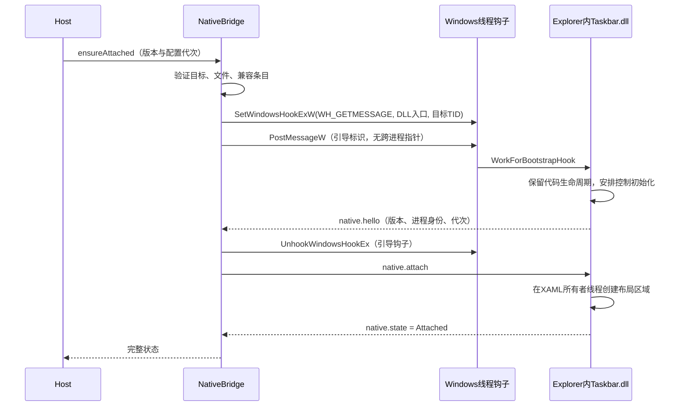

# 自带任务栏组件实现设计

更新日期：2026-10-30。此方案替换外部任务栏框架路线；自有加载器和适配器已实现，本机真实布局与恢复已验证，详见[实现进展](实现进展.md)。以下包含当前原型和后续发布目标。

## 1. 交付形态与技术选择

用户安装一个 WorkFor MSI。安装包包含自己的原生加载器与 DLL，不要求用户安装 Windhawk、编译器或开发 SDK。

| 产物 | 技术 | 运行位置 |
|---|---|---|
| `WorkFor.NativeBridge.exe` | C++23 / Win32，x64 | 当前登录用户的独立进程 |
| `WorkFor.Taskbar.dll` | C++23 / C++/WinRT / 系统 XAML，x64 | 当前会话的任务栏 Explorer 进程 |
| `compatibility.json` | 版本化的静态兼容条目 | 安装目录，由加载器读取并校验 |
| 第三方库 | WIL、nlohmann/json、需要时使用 MinHook | 编译到自身原生二进制中，不增加外部常驻程序 |

DLL 引导使用目标线程限定的 `SetWindowsHookExW(WH_GETMESSAGE, ...)`。MinHook 只在适配器确有必要修改已验证内部函数时使用，静态链接；它不负责 DLL 注入，不代替本项目的布局研究。

公开引导接口与非公开任务栏适配必须分开描述：前者有 Windows 文档，后者没有微软的稳定兼容保证。没有验证布局前，即使 DLL 已加载也不能宣布产品目标完成。

## 2. 目标发现与权限

NativeBridge 必须拥有消息循环。启动时先枚举当前交互桌面任务栏窗口，再由 `GetWindowThreadProcessId` 获取真实进程 / 线程，不通过“扫描所有 explorer.exe 然后逐个尝试”确定目标。

每个目标建立 `TargetIdentity`：

```text
userSid + sessionId + processId + processCreationTime
architecture + integrityLevel + explorerImagePath
taskbarHwnd + taskbarThreadId + moduleFingerprint
```

验证进程路径、会话、用户及完整性级别；用 `IsWow64Process2` 检查实际架构。首版仅允许同用户、同会话、标准完整性级别的 x64 Explorer。线程 / PID 变化后完整重验，防止 HWND / PID 复用。

保留 Explorer 进程句柄用于等待退出，不把长期持有一个 HWND 当作进程存活证明。只申请查询与同步所需权限，不申请任意进程内存写入权限。

加载被策略或权限阻止时返回 `LOAD_POLICY_BLOCKED` / `TARGET_IDENTITY_MISMATCH`，计算和设置保持可用。不自动提权、不使用系统服务或驱动，不通过关闭系统防护完成加载。

### 发现事件

- 启动时枚举一次。
- 注册 `TaskbarCreated` 消息，由普通隐藏顶层控制窗口接收；不能假设 message-only window 会收到广播。
- `SetWinEventHook` 使用 `WINEVENT_OUTOFCONTEXT` 监听必要的窗口创建 / 销毁事件；回调仅投递发现任务，避免重入。
- 等待已识别 Explorer 的进程退出。
- 事件遗漏时低频重新枚举，退避上限 30 秒；不每秒扫描系统进程。

窗口创建事件可能较多，必须过滤任务栏候选并合并触发。`SetWinEventHook` 不承担 DLL 注入。

来源：[SetWinEventHook](https://learn.microsoft.com/en-us/windows/win32/api/winuser/nf-winuser-setwineventhook)。

## 3. 加载与引导时序



### 3.1 NativeBridge 侧

1. 从安装清单选择固定版本的 DLL 绝对路径，验证 SHA-256；发行版同时验证签名。路径只允许位于受管理版本目录，拒绝从脚本或管道参数任意指定 DLL。
2. 使用 `LoadLibraryExW` 在 NativeBridge 内取得 DLL 与导出入口。**在加载器自身调用普通 `LoadLibrary` 不会把 DLL 放入 Explorer**；跨进程加载由后续目标线程钩子引导。
3. 以非零目标线程 ID 调用 `SetWindowsHookExW`，只处理当前任务栏相关线程，禁止 `dwThreadId=0` 的桌面全局钩子。
4. 通过 `PostMessageW` 向目标窗口发送注册的引导消息；消息包含版本与尝试编号等整数，不携带本进程地址、文件路径指针或密码。
5. 等待受限的握手超时，初值 5 秒；同一目标最多一个引导尝试。超时移除引导钩子、记录失败，不无界重试。
6. DLL 已确认独立持有其代码生命周期后才移除引导钩子。挂钩成功仅等于进入 `Bootstrapping`，后续仍需协议、适配与空间验证。

加载器自身可设置安全 DLL 搜索路径，并为每次 `LoadLibraryExW` 限定安装目录和系统目录；不能在 Explorer 内调用 `SetDefaultDllDirectories` 改写整个宿主进程的全局搜索策略。Taskbar DLL 的非系统依赖优先静态链接，避免系统加载钩子 DLL 时再次解析一个不受控的私有 DLL 搜索链。

目标线程受保护、架构不符、消息不被处理或系统不允许该钩子时应结束为不支持状态；不增加其他通用注入方式作为隐藏兜底。

来源：[SetWindowsHookExW](https://learn.microsoft.com/en-us/windows/win32/api/winuser/nf-winuser-setwindowshookexw)、[DLL 搜索路径](https://learn.microsoft.com/en-us/windows/win32/api/libloaderapi/nf-libloaderapi-loadlibraryexw)。

### 3.2 DLL 侧

导出入口遵循 Windows ABI：

```cpp
extern "C" __declspec(dllexport)
LRESULT CALLBACK WorkForBootstrapHook(int code, WPARAM wParam, LPARAM lParam);
```

- `DllMain` 只保存模块实例和初始化所需的最小标志；不初始化 COM / XAML，不开管道、不等待其他线程、不执行重型全局构造。
- 引导回调先处理 `code < 0`，正常情况下继续 `CallNextHookEx`；只识别本项目引导消息，并避免在 `PM_NOREMOVE` 重复执行初始化。
- 在目标进程中再校验自己确实处于预期 Explorer；加载器自身的 DLL 副本不附着 UI。
- 初始化入口幂等，原子状态防止多个窗口 / 线程同时启动多份 IO worker。
- 首版在首次合法引导时用 `GetModuleHandleExW(FROM_ADDRESS | PIN, ...)` 保留 DLL 到进程退出，再安排普通控制流程初始化。这是保守的代码生命周期策略，不是物理卸载方案。
- 回调立即返回；管道握手、能力判断和其他耗时工作转到控制线程。UI 操作单独投递到真实 XAML 所有者线程，不假设任务栏 HWND 所在线程必然拥有 XAML 树。

静态 CRT 可能需要线程通知，不能不加分析就调用 `DisableThreadLibraryCalls`。不得在 `DllMain` 中获取初始化业务锁并等待初始化结束。

来源：[DLL 最佳实践](https://learn.microsoft.com/en-us/windows/win32/dlls/dynamic-link-library-best-practices)、[模块 PIN 语义](https://learn.microsoft.com/en-us/windows/win32/api/libloaderapi/nf-libloaderapi-getmodulehandleexw)。

## 4. 任务栏对象访问与布局钩子

引导代码只获得 Explorer 内的执行位置，不会自动得到 XAML 根对象。各版本适配器负责：

1. 通过经原型验证的任务栏对象入口 / XAML 观察机制发现正确 UI 根、调度器及布局容器。
2. 将已有任务栏与后续新建任务栏都纳入观察，避免只依赖创建事件而漏掉已存在根对象。
3. 用结构、类型、线程归属和模块指纹判断可用性；无法定位时报告 `ROOT_NOT_FOUND`。
4. 为控件建立本模块的所有权标记，防止重复插入与误删系统 / 其他应用元素。
5. 在实际测量 / 排列流程中预留宽度；必要时使用 MinHook 修改精确匹配的内部测量函数。
6. 只更新自有布局贡献，移除时不覆盖其他程序后来修改的属性。

所有内部入口与 XAML 类型均在 P0 记录，不提供一个未经验证的通用函数名。优先采用不需代码补丁的已验证接入方式；需 inline hook 时，地址、函数 ABI、预期字节和回滚路径都必须匹配。

MinHook 原型不得开启全部未知钩子；按本模块目标逐一创建，队列化启用，并验证错误码。不要用 `MH_ALL_HOOKS` 操作其他模块可能持有的钩子。若目标已被修改且无法确认共存安全，报告 `HOOK_CONFLICT`，不覆盖现有补丁。

**MinHook 能生成 trampoline，不会解决 XAML 对象有效性、系统升级或布局逻辑正确性。** 它是否需要纳入最终产物由 P0 结果决定；若需要，采用核实的最新稳定版 1.3.4 静态链接。

来源：[MinHook 项目及版本](https://github.com/TsudaKageyu/minhook)。

## 5. 内部接口与握手

### 5.1 Host 到 NativeBridge

继承的私有 stdin/stdout 使用现有 4 字节长度 + UTF-8 JSON 帧；stdout 仅用于协议。接口为：

| 消息 | 请求 | 返回 |
|---|---|---|
| `bridge.ensureAttached` | ABI 版本、配置代次、请求 ID | 已发现目标、当前状态、适配器版本 |
| `bridge.queryState` | 请求 ID | 加载 / 附着 / 租约 / 延迟更新状态 |
| `bridge.detach` | 请求 ID、原因 `shutdown/update/uninstall` | `Detached`、`DetachPending` 或错误 |
| `bridge.status` | 事件推送 | Explorer 身份、状态变化和稳定错误码 |

加载器重新核实 Host 传入的目标和路径，不能把该接口做成“任意 PID + 任意 DLL 路径”的工具。

### 5.2 NativeBridge 到 Explorer DLL

控制管道：`\\.\pipe\workfor-native-v1-{SID}-{session}`；NativeBridge 为服务端，DLL 为客户端。名称可由双方根据用户 / 会话确定，避免 DLL 尚未握手就必须知道随机代次的发现循环。每个会话一个 NativeBridge 互斥体，管道服务端要求首实例创建；无法独占时停止并报告冲突。管道访问控制、帧长度与主 IPC 一致，单帧最多 16KiB。

握手内容：`nativeAbiVersion`、`bridgeVersion`、`moduleVersion`、模块哈希、目标 PID / 创建时间、能力位。当前控制端随机 `generation` 由 NativeBridge 在 `native.accept` 中分配，此后控制消息都带该代次；重连后丢弃旧连接排队消息。使用 `GetNamedPipeClientProcessId` / `GetNamedPipeServerProcessId` 与目标身份交叉核对，握手不能只信消息正文中的 PID。

引导消息中的尝试编号用于关联，不能当作安全凭据；同用户恶意软件仍不属于该 IPC 的安全隔离范围。关键路径、版本和发布清单由安装目录确定，不从窗口消息读取任意路径。

| 消息 | 语义 |
|---|---|
| `native.hello` / `native.accept` | 版本、身份、代次确认 |
| `native.attach` | 请求按指定能力与宽度加入任务栏布局 |
| `native.state` | `Negotiating/Attaching/Attached/Detaching/Dormant/Unsupported` |
| `native.lease` | 当前控制端存活租约，不携带工资或脚本 |
| `native.detach` | 移除本项目 UI 与活动回调，进入休眠 |
| `native.diagnostic` | 有界错误码、计数与耗时，禁止完整工资参数 |

真正用于显示的快照仍由 Host 的显示管道发给 DLL；NativeBridge 不重复解释工资或运行 JavaScript。

ABI v1 是进程间协议版本；不能把一个本地 C++ 对象指针或函数地址传给其他进程后直接调用。跨 DLL 的同进程接口如需扩展，只使用固定宽度整数、版本号、长度和明确所有权的 C ABI，不暴露 STL / C++ 异常。

## 6. 逻辑分离、休眠与物理卸载

### 首版采用的明确策略

**逻辑分离后 DLL 仍驻留，直至该 Explorer 自然退出。** `GetModuleHandleExW(PIN)` 的语义就是进程结束前不卸载。程序退出不意味着本 DLL 已从 Explorer 地址空间移除。

停止流程：

1. 原子切换为 `Detaching`，拒绝新附着与显示任务。
2. 在所有者线程移除自有控件，撤销 XAML 事件、观察订阅与计时器，移除自身布局贡献。
3. 取消管道 IO，终止自身后台工作，清空排队操作，解除对 Host / NativeBridge 的依赖。
4. 已安装的 detour 切为无业务状态的 pass-through；保留代码、原函数 trampoline 与必要最小状态，避免仍在途的原函数调用返回到已释放地址。
5. 内部活动计数归零且不再引用 UI 对象后，报告 `Dormant`；保留的被动入口只能直接转发原函数。

首版不在休眠路径调用 `MH_RemoveHook` / `MH_Uninitialize` 释放仍可能被线程使用的 trampoline。是否能移除 inline patch 同样需要专门证明；不能把“活动计数某次读到零”当成所有未来回调也不可能进入的证明。

`UnhookWindowsHookEx` 返回时仍可能存在在途钩子回调，因此不能据此直接 `FreeLibrary`。也不能用重复 `FreeLibrary`、远程线程或终止 Explorer 来凑出“热卸载成功”。

来源：[UnhookWindowsHookEx 的并发语义](https://learn.microsoft.com/en-us/windows/win32/api/winuser/nf-winuser-unhookwindowshookex)。

### 分离失败

UI 线程长时间无响应、无法证明布局已恢复时报告 `DetachPending`；保留必要对象与代码，不释放可能仍被引用的内存。该状态下不能加载第二版组件。原型需要单独验证此路径，保证不把超时当成完整卸载。

未来若要无重启的物理热卸载，需要另加完整的回调撤销、线程静默点、对象引用与 trampoline 生命周期证明，并以独立版本交付；本版不承诺。

## 7. 重连、进程退出与崩溃隔离

- NativeBridge 在 Host 的受控 Job 内运行；Host 退出时关闭引导钩子并停止子进程。异常退出路径不保证应用级析构全部执行，DLL 必须独立处理租约丢失。
- DLL 在租约丢失 5 秒后把显示标为非实时；30 秒仍无法恢复则尝试逻辑分离，进入 `Dormant`，不在 Explorer 内执行无限忙等。
- Host / NativeBridge 恢复后，先枚举目标已加载的本项目模块并匹配创建时间与路径，优先用**同一个已驻留版本**重新握手。不能因为 PID 未变就盲目复用旧对象。
- 休眠版本可在合法控制握手后重新附着；初始化和清理必须幂等，每个 Explorer 生命周期只有一个本项目原生组件版本。
- Explorer 进程退出后，其对象和 DLL 映射消失。下一目标必须重新完成身份、文件与兼容性验证。
- 运行状态记录放在数据目录，按目标创建时间验证；文件不是模块存活证明，发现信息必须经进程 / 管道实际状态确认。

附着前记录尝试，稳定运行确认后更新检查点。短期内 Explorer / 加载器多次异常退出时触发隔离：初始预算为 10 分钟内 3 次，将该模块 / 目标指纹置为 `Quarantined`。记录“相关异常”而不是未经证明地断言由本 DLL 导致。

隔离只停止再次附着任务栏，计算继续运行，设置界面展示原因。用户明确重试或安装已验证的新兼容条目后再恢复，不自动无限重试导致 Explorer 崩溃循环。

## 8. 兼容清单与地址解析

`compatibility.json` 跟随应用发布，只包含已在 P0 通过验证的条目。实现阶段生成后填写：

```json
{
  "schemaVersion": 1,
  "nativeAbiVersion": 1,
  "adapters": []
}
```

空数组意味着当前没有经验证的适配器，不能默认放行。每个实际条目至少记录：

- 架构、Windows 构建族、Explorer / 实际任务栏模块的文件版本和 SHA-256。
- 适配器 ID、经过验证的 XAML / 布局能力及目标位置。
- 确有必要时记录内部函数 RVA、函数 ABI、预期代码字节与 PDB GUID / age。
- 真实测试环境、结果、已知限制和所需本地组件版本。

ASLR 地址为实际模块基址 + 对应精确文件版本的 RVA；不能把某次调试地址直接写成绝对地址。PDB 调试 ID 只作为匹配依据，程序不要求用户联网下载符号。

未知模块哈希、字节不符或 UI 结构变化时返回 `UNSUPPORTED_BUILD`。先更新适配条目与代码再验证，不采用跨版本猜偏移或宽松全内存签名扫描。用户日常运行不依赖在线符号服务。

如果 P0 证实最新系统补丁需要新的内部接入方法，更新设计记录；不能以伪造兼容条目让未验证版本进入生产。

## 9. 安装与升级的实际含义

原生 DLL 的保守驻留策略决定版本目录与升级设计：

```text
%LOCALAPPDATA%\Programs\WorkFor\
  launcher.exe
  versions\{appVersion}\
    WorkFor.Host.exe
    WorkFor.NativeBridge.exe
    WorkFor.Taskbar.dll
    WorkFor.ScriptHost.exe
    WorkFor.UI.exe
    compatibility.json
    native-assets.json
```

原生版本目录在模块仍被 Explorer 映射时保留，尤其是用于重新握手的同版 NativeBridge / DLL 文件。加载器对路径做最终解析，拒绝版本目录内的任意 reparse 跳转。发行 DLL 优先静态 CRT 和第三方库；不把设置程序的 .NET / WinUI 依赖带入 Explorer。

同一 Explorer 生命周期不同时启用两版 Taskbar DLL。更新安装新版本目录后：

1. 兼容的 Host / UI 可先更新，但在当前 Explorer 中继续与旧原生 ABI v1 协作；需要加载器重连时使用保留的同版 NativeBridge。
2. 新 Taskbar DLL 标为“下次登录或 Explorer 重启后生效”。旧版本在已映射期间仍需可读取、验证与重新引导，不改名或覆盖其路径。
3. 若新 Host 不兼容旧原生版本，更新计划应整体延后激活，或让用户明确选择重启 Explorer 后完成，不能安装完才发现 IPC 无法协作。
4. 不静默关闭 / 重启 Explorer，不把终止 Shell 当作普通释放锁文件方法。

MSI 必须单独验证 Restart Manager、文件占用提示、回滚和逐版本目录保护。安装 / 卸载时关闭自己的进程，不授权安装器无提示终止 Explorer。对于不能立即删除的驻留 DLL，只使用经验证且当前安装权限允许的清理能力；每用户安装不能假设有权调用系统级重启删除队列。无法完成延期清理时，明确提示用户退出登录后重试卸载。不能承诺退出程序后所有文件一定立即消失，也不能为删除文件临时升级成管理员常驻服务。

### 构建职责

原生工程使用 Visual Studio Build Tools 的最新稳定 C++ 工具集、CMake / Ninja；开发机与 CI 固定精确版本。开发依赖通过固定版本和哈希恢复，代码评审可追溯。

发布版 Taskbar DLL 自包含其非系统原生依赖，开启适用的 ASLR、DEP、CFG 与编译器诊断；inline hook 与 CFG 的实际共存需 P0 验证。自带实现不等于零依赖源码，而是用户无需单独安装第三方宿主程序。

## 10. P0 门禁与新增测试

| 门禁 | 通过条件 |
|---|---|
| 目标身份 | 非本用户、非本会话、非 x64、非标准 Explorer 均不会进入加载步骤 |
| 引导 | 回调只在指定目标线程初始化、握手后移除引导钩子、超时有界 |
| 原生框架 | 不初始化另一套 WinUI 到 Explorer；找得到真实 UI 所有者线程 |
| 真实布局 | 金额区域参与布局测量，拥挤与溢出场景不覆盖应用和托盘 |
| 逻辑分离 | UI、IO 和事件均停止；在途调用不会跳入已释放 DLL / trampoline |
| 恢复 | Host / NativeBridge 退出、休眠重连、Explorer 重启均不重复附着 |
| 兼容清单 | 未知文件版本 / 哈希 / ABI 拒绝，不猜地址 |
| 升级 | 驻留旧版时不加载第二版；旧目录保留；延迟生效和安装回滚可操作 |
| 隔离 | 快速异常退出达到预算后不再自动附着，后台计算仍工作 |

这些都需要原生真机 / 虚拟机验证。当前已对本机精确任务栏指纹完成私有根对象解析、真实布局插入、实时更新与恢复实验；其余平台与生命周期资格门禁不能据此推断已经通过。
